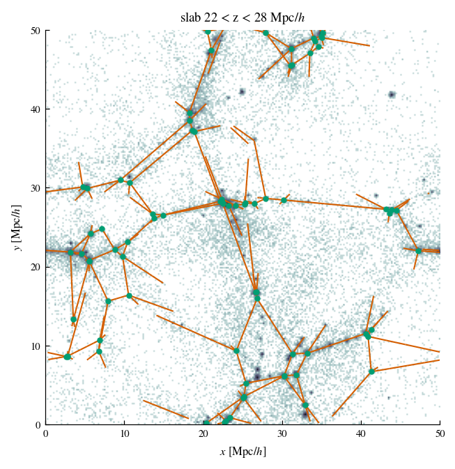
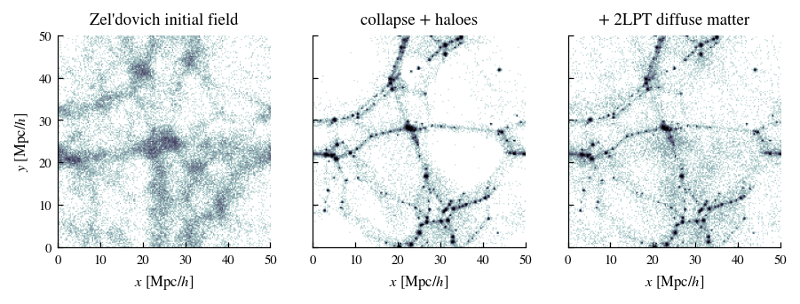

# gtweb — mock cosmic webs with a known filament network

`gtweb` builds a mock cosmic web whose **filaments and nodes are known exactly**, and realises it as a
dark-matter-like particle field. Run your filament finder (DisPerSE, NEXUS, T-web, Bisous, a
spanning tree, a machine-learning model, ...) on the particles and measure directly which true
filaments it finds, which it misses and what it invents. You don't need another finder's output as
"truth".



A cosmological simulation has no independent filament catalogue to score a finder against: a
filament is defined by the finder that extracts it. `gtweb` provides a complete, hierarchical web
with a realistic density field in which the spine of every filament is fixed by construction:

* voids with a broad range of sizes (in a 100 Mpc/h box, cells span effective radii of about
  3–25 Mpc/h), seeded by the minima of a ΛCDM initial density field;
* a closed-form skeleton (nodes and straight filament spines), computed without running any finder;
* matter collapsed onto walls, filaments and nodes, NFW haloes strung along the filaments and
  clustered at the nodes, and faint uncollapsed matter in the voids;
* per-filament and per-node strengths measured on the final field, so recovery can be studied as a
  function of how faint a filament is.

The mock was introduced to benchmark density inputs for the DisPerSE filament finder
(Singh et al., in preparation); the defaults reproduce that paper's construction.

## Install

```bash
pip install git+https://github.com/ansingh16/gtweb.git
# or, to run the notebooks and tests
git clone https://github.com/ansingh16/gtweb.git
cd gtweb
pip install -e ".[notebooks,test]"
```

Requires pip ≥ 21.3 (for `pyproject.toml` installs). Only `numpy` and `scipy` are required. `matplotlib` is used by the notebooks. `numba` is optional
and speeds up one binning step.

## Quick start

```python
import gtweb

# a 50 Mpc/h box with 64^3 particles: about a minute and 3 GB of memory
meta = gtweb.generate_mock("my_mock", box=50.0, ngrid=64, seed=1)

truth = gtweb.load_ground_truth("my_mock/ground_truth_spines.npz")
particles = gtweb.load_particles("my_mock/mock_particles_s1.npz")["positions"]

# ... run your finder on `particles`, giving a list of (M,3) polylines or an (N,3) point cloud ...
my_skeleton = gtweb.read_disperse_skeleton("my_run.a.NDskl")      # e.g. a DisPerSE ASCII skeleton

gtweb.score_finder(my_skeleton, truth["spines"], truth["box_size"], tol=1.0)
# -> {'completeness': ..., 'purity': ..., ...}
gtweb.score_per_filament(my_skeleton, truth["spines"], truth["box_size"], tol=1.0)
# -> the recovered fraction of every true filament
```

## Notebooks

| notebook | what it shows |
|---|---|
| [`01_quickstart`](notebooks/01_quickstart.ipynb) | generate a mock, inspect the outputs, plot the true web, score a simple finder overall and filament by filament |
| [`02_how_the_mock_is_built`](notebooks/02_how_the_mock_is_built.ipynb) | each construction step run by hand, with figures |
| [`03_score_your_finder`](notebooks/03_score_your_finder.ipynb) | a worked DisPerSE example: run it on the mock, score it, set its threshold on the true nodes, find which filaments it misses |

The notebooks are stored with their outputs, so you can read them on GitHub without running them.

## How the mock is built



1. **Initial conditions.** `gaussian_psi1` draws a Gaussian random field with the linear ΛCDM power
   spectrum (Eisenstein & Hu 1998 no-wiggle transfer function; Planck/MDPL2 cosmology,
   Ω_m = 0.307, h = 0.6777, σ₈ = 0.8228, n_s = 0.96) and returns its Zel'dovich displacement Ψ₁ at
   z = 0 linear amplitude. The particle load is x = q + Ψ₁. You can supply your own Ψ₁ instead
   (`generate_from_ic`).
2. **Voids.** The particles are binned on a grid with 0.78 Mpc/h cells and smoothed with a
   1.5 Mpc/h Gaussian. About each density minimum a sphere grows until its mean enclosed density
   rises to 0.2 ρ̄. Candidates are accepted largest first, any whose centre lies inside an accepted
   void is rejected (so small voids nest inside large ones), and the radii are trimmed until no two
   spheres overlap. The centres are the **nuclei**, one per void.
3. **Cells.** The spheres fill only about a fifth of the box, so an ordinary Voronoi tessellation of
   the nuclei would make all cells about the same size. Instead a power (Laguerre) tessellation is
   used, in which a point x belongs to the nucleus cᵢ that minimises |x − cᵢ|² − wᵢ. The weights wᵢ
   are fitted by gradient ascent so that each cell's volume is proportional to the cube of its
   sphere's radius (to about 1 per cent).
4. **Skeleton.** The nodes are the vertices of the tessellation and the filaments the straight cell
   edges joining them, computed in closed form.
5. **Particles.**
   * *Collapse.* Each particle is pushed away from its nucleus, x → cᵢ + (1 + Tᵢ)(x − cᵢ), and if this
     takes it out of its cell it is projected onto the nearest face, edge or vertex, so it ends in a
     void, wall, filament or node. Tᵢ = 0.98 (Rᵢ / median R)^½ grows with the void radius Rᵢ, so
     large voids empty further.
   * *Thickness.* Walls and filaments get a Gaussian thickness of 0.25 Mpc/h.
   * *Haloes.* The filament and node particles join their nearest density peak (after 0.3 Mpc/h
     smoothing); each peak holding at least 20 particles is redrawn as an NFW profile with
     concentration 6. Forty per cent of the filament particles stay in place as smooth bridges
     between haloes. Mass is conserved.
   * *Diffuse matter.* 32 per cent of the particles are replaced by the second-order Lagrangian
     (2LPT) realisation of the same initial conditions, which fills the voids with faint,
     uncollapsed structure.

The truth is the skeleton of step 4. On the final field we measure each filament's mean density
contrast along its spine (ρ/ρ̄ on a 256³ grid smoothed by 0.5 Mpc/h) and each node's mass within
1.5 Mpc/h.

In the paper, the diffuse fraction and the wall thickness were fitted jointly to field statistics of
a dark-matter simulation (deep-void volume fraction, median density, mass fraction above ten times
the mean, and the density scatter inside voids). Every other setting was fixed. All settings are
arguments of `generate_mock` / `generate_from_ic` and are recorded in `metadata.json`.

## Outputs

| file | contents |
|---|---|
| `mock_particles_s{seed}.npz` | `positions` (N,3) [Mpc/h], `stage` (0 void, 1 wall, 2 filament, 3 node; diffuse particles are 0), `velocities` (N,3) [km/s] |
| `ground_truth_spines.npz` | `spine_i` (the true filaments; load with `load_ground_truth`), `filament_lengths`, `filament_target_contrast` (mean ρ/ρ̄ along the spine), `filament_lambda` (mass per unit length within 1 Mpc/h), `node_positions`, `box_size` |
| `nodes_catalogue.npz` | node `positions` and `peaks` (mass within 1.5 Mpc/h) |
| `halos_catalogue.npz` | the mock's haloes: `positions`, `mass`, `n_particles` |
| `web_geometry.npz` | the tessellation: nuclei, weights, void radii |
| `velocity_field.npz` | 2LPT velocity cube (read with `load_velocity_field`, sample with `sample_velocity`) |
| `metadata.json` | every setting and the resulting counts |

Units are Mpc/h, M⊙/h and km/s, on a periodic box. Spines are stored wrapped into the box; apply the
minimum-image convention before differencing consecutive points.

## Size and run time

The physical settings are in Mpc/h, so the particle number only sets the resolution. Measured on a
single machine:

| box [Mpc/h] | particles | voids / nodes / filaments | time | peak memory |
|---|---|---|---|---|
| 50 | 64³ | 69 / 430 / 854 | ~1 min | 2.9 GB |
| 100 | 128³ | 506 / 3,113 / 6,120 | ~7 min | 3.4 GB |
| 100 (paper) | 384³ | 483 / 2,968 / 5,842 | not timed with this package | — |

The Laguerre fit dominates the run time for small particle numbers; its cost scales with the box
volume.

## Using the mock fairly

* **One mock is one realisation.** Use several seeds and report the scatter.
* **Match your data.** Subsample the particles to the tracer density you care about, or use the
  halo catalogue as a discrete tracer.
* **Purity has a floor.** The diffuse matter is not tied to the tessellation and forms some faint
  structure of its own away from the true spines. In the paper's mock, 80 per cent of the overdense
  mass lies within 1.5 Mpc/h of a true spine. A finder that traces the rest is charged with false
  detections.
* **Nodes join four filaments.** Every vertex of a three-dimensional tessellation joins four edges,
  so the mock cannot test how connectivity rises with node mass.
* **Walls are planar** cell faces and **filaments are straight.**
* **Velocities** are the 2LPT velocities of the initial field (the bulk flow), not an evolved,
  self-consistent velocity field. They are not suitable on their own for testing velocity-based web
  classifiers.
* **Box size.** A periodic box truncates the largest voids and longest filaments.

## Tests

```bash
pytest tests
```

The tests generate a small mock (40 Mpc/h, 48³ particles) and check the initial power spectrum,
determinism, the geometry of the truth, that the mass sits on the web, and the scorer.

## Citation

If you use `gtweb`, please cite the paper that introduces the mock (Singh et al., in preparation;
the reference will be added here on publication) and this repository (see `CITATION.cff`).

## Licence

MIT; see `LICENSE`.
